# FamilyPulse 📅

A Flutter + Firebase family calendar app that finds shared free time across school, hobbies, and work schedules — with family groups, member roles, recurring events, reminders, profile photos, and a weather forecast that flags outdoor plans at risk of rain.

**Status: feature-complete.** Every item on the roadmap is built and merged into `main`.

---

## Screenshots

<!--
  Drop the actual PNGs into docs/screenshots/ using the filenames below and
  these will render automatically — no other edits needed. Recommended:
  a phone-width screenshot (e.g. 390x844) from either the iOS simulator,
  an Android emulator, or `flutter run -d chrome` at a narrow window size.
-->

| | | |
|---|---|---|
| 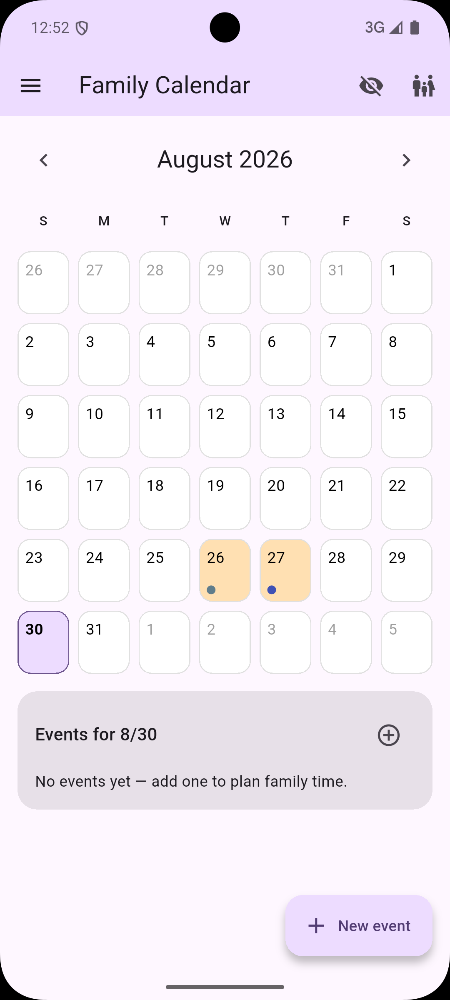 | 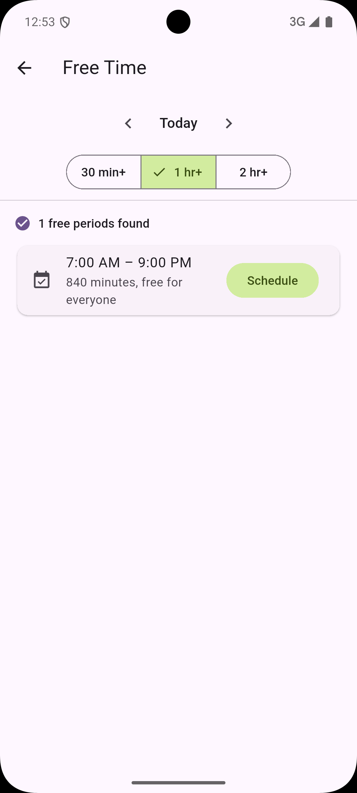 | 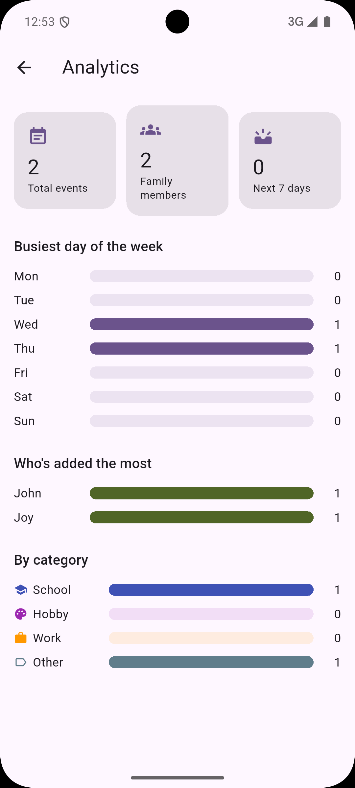 |
| Family calendar (Pulse) | Free-time finder | Analytics |
| 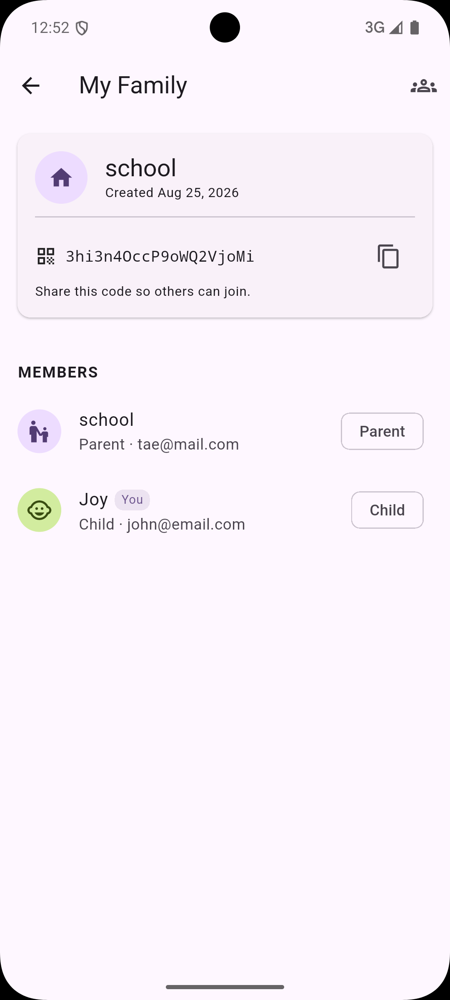 | 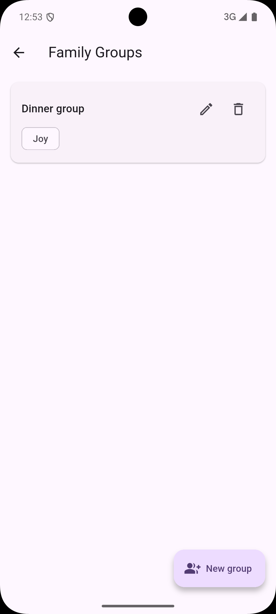 | 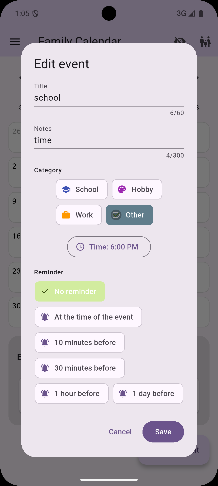 |
| Family code + member roster | Family groups | Edit event — reminder picker |
| 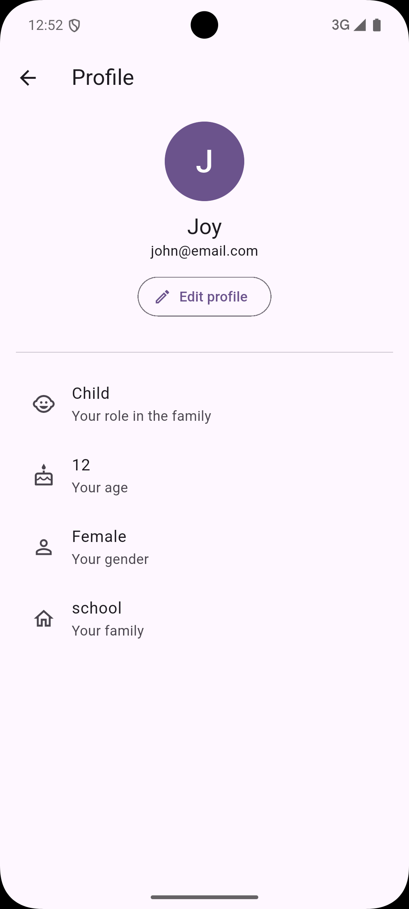 | 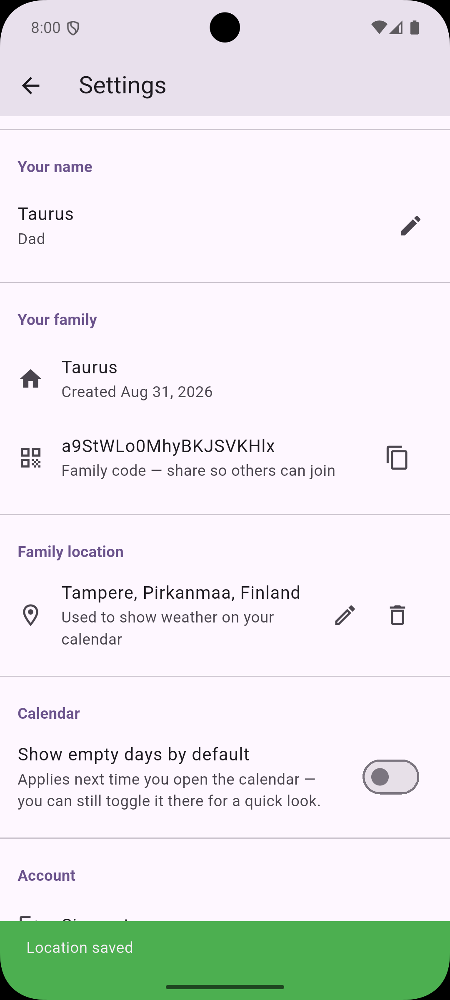 | 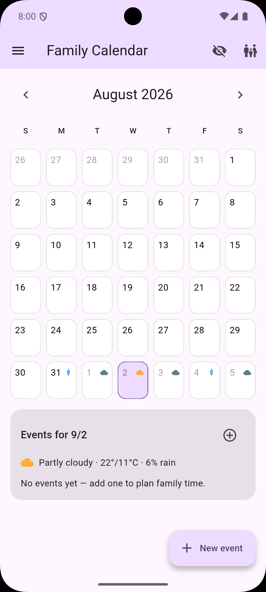 |
| Profile — age, gender | Family location — set once by a parent | Weather forecast on the calendar |

### Live web build

The app also runs in the browser with no install step, deployed to
Firebase Hosting at **https://family-pulse-sznzoj.web.app**.

| | | |
|---|---|---|
| 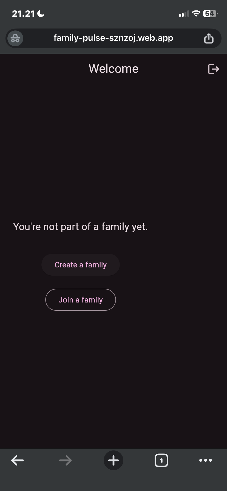 | 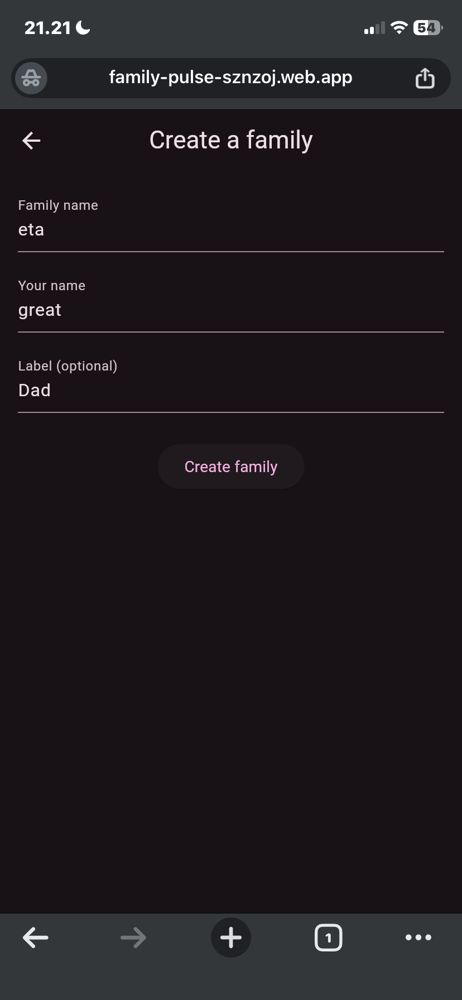 | 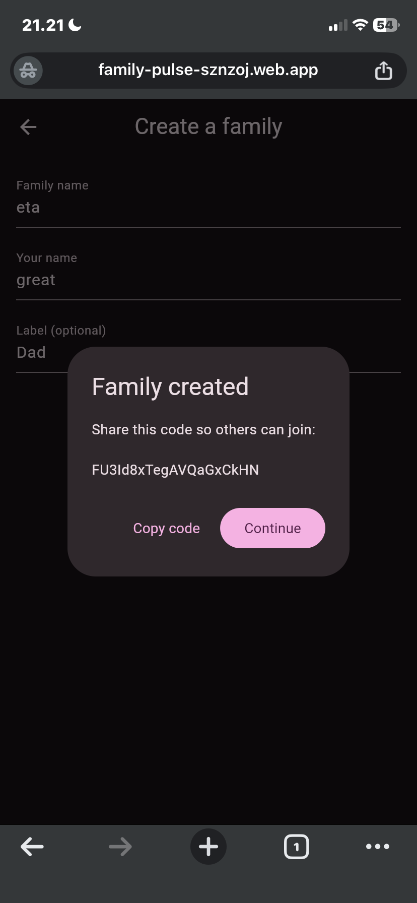 |
| Signed in, no family yet | Create-a-family form at phone width | Invite code returned and copyable |

| | |
|---|---|
| 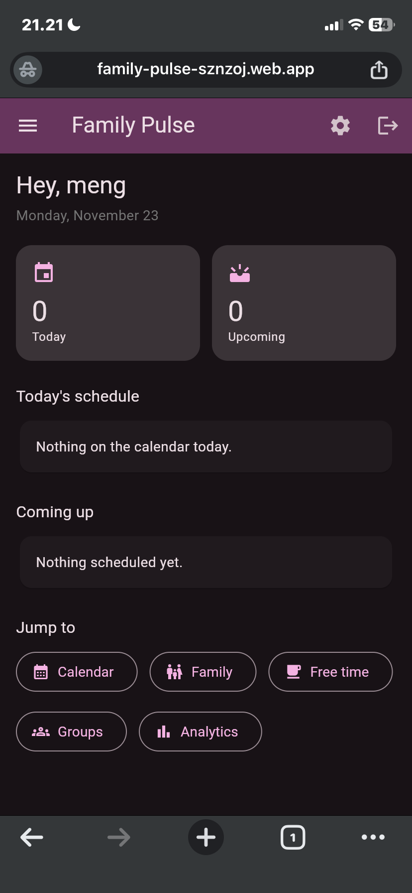 | 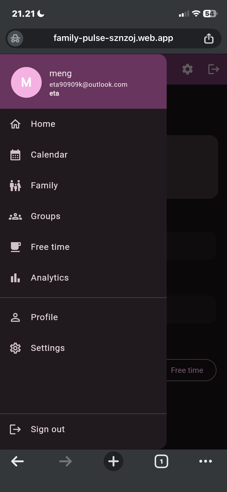 |
| Pulse home on iOS Safari | Navigation drawer |

See [docs/screenshots/web/](docs/screenshots/web/) for capture details.

---

## Try it without installing anything

The web client is live and needs no build step, emulator or device:

**https://family-pulse-sznzoj.web.app**

A demo family is seeded with three members and fourteen days of overlapping
work, school and evening commitments, so the free-time search has something
realistic to work on.

| Member | Email | Password |
|---|---|---|
| Anne (reviewer) | `anne@familypulse.demo` | `FamilyPulse2026!` |
| Mikko | `mikko@familypulse.demo` | `FamilyPulse2026!` |
| Sofia | `sofia@familypulse.demo` | `FamilyPulse2026!` |

Sign in as any of them, open **Free time**, and tap **Find time across
several days**. The schedules are deliberately awkward — most days have no
three-hour window, which is what makes the days that do worth finding.

---

## Architecture

FamilyPulse is a Flutter client on Firebase. One capability — the multi-day
shared free-time search — runs on Azure instead, and the split is deliberate:

```
Flutter client  ──────────────►  Firebase Auth      identity
(web + Android)                  Cloud Firestore    all data
       │
       │  POST /api/free-slots
       │  Authorization: Bearer <Firebase ID token>
       ▼
Azure Function  ──────────────►  Cloud Firestore    reads, never writes
(Node, Norway East)              (via Admin SDK)
```

**Firebase stays the system of record.** The Azure Function issues no tokens,
stores no users and owns no data. It verifies the caller's existing Firebase
ID token, confirms that the token's uid belongs to the family being queried,
reads the same documents the client already reads, and returns a computed
answer. Nothing was migrated; Azure supplies compute where Firebase is a poor
fit.

### Why that one feature moved

The single-day free-time finder stays on the device. It reads one day of
events and must feel instant.

Searching two weeks is a different shape of problem: substantially more
documents, the scan repeated per day per member, and — the deciding factor —
every member of the family would otherwise compute an identical answer on
their own phone. Moving it server-side makes it one computation, keeps the
work off low-end devices, and puts the result somewhere it can later be
cached or scheduled.

### The security consequence of using the Admin SDK

The Admin SDK **bypasses Firestore security rules entirely** — it is trusted
by definition. The membership guarantee that rules provide for free on the
client path therefore has to be re-implemented by hand in the function:

```js
const callerDoc = await db.collection('families').doc(familyId)
  .collection('users').doc(claims.uid).get();
if (!callerDoc.exists) return json(403, { error: 'not_a_family_member' });
```

Without those lines, any authenticated FamilyPulse user could read any
family's calendar by changing one field in the request body. Full detail in
[`azure-functions/README.md`](azure-functions/README.md).

### Infrastructure

| | |
|---|---|
| Web hosting | Firebase Hosting (`family-pulse-sznzoj.web.app`) |
| Compute | Azure Functions, Node on Functions v4 |
| Region | Norway East |
| Resource group | `familypulse-ne` |
| Storage | `fpstoresznzoj` — Standard_LRS, public blob access disabled |

Azure Static Web Apps was the original hosting target. The subscription
carries an **Allowed resource deployment regions** policy permitting only
`belgiumcentral`, `norwayeast`, `austriaeast`, `switzerlandnorth` and
`italynorth`; Static Web Apps exists in none of them, and the portal's region
dropdown gives no warning because it lists where the *service* runs, not where
*this subscription* may deploy. Azure Functions is available in all five, so
hosting moved to Firebase and the compute layer stayed on Azure as planned.

---

## Getting Started

### Prerequisites

- Flutter 3.44.4+
- Dart 3.12+
- VS Code with Flutter + Dart extensions
- Android Studio (for an Android emulator) and/or Xcode (for iOS)
- Firebase CLI

### Setup

```bash
# 1. Clone the repo
git clone https://github.com/rex-daworker/family_pulse.git

# 2. Enter the project
cd family_pulse

# 3. Install packages
flutter pub get

# 4. Run the app
flutter run
```

### Firebase setup

The app expects `android/app/google-services.json` and
`ios/Runner/GoogleService-Info.plist` for the Firebase project
`family-pulse-sznzoj` (not committed — ask Rex for a copy, or point
`firebase_options.dart` at your own project).

Two things worth knowing if you're setting this up fresh:

- **Firestore and Auth work on Firebase's free Spark plan.** Profile
  photo upload does not — Firebase Storage requires the pay-as-you-go
  **Blaze** plan to be enabled at all, even for trivial usage within its
  free tier (5GB stored / 1GB day download). Set a Cloud Billing budget
  alert when you enable it so nothing runs away unnoticed.
- After enabling Storage, deploy the security rules once:
  `firebase deploy --only storage`.

The weather forecast needs no setup at all — Open-Meteo is keyless, so
there's no account, billing, or `.env` entry to configure for it.

---

## Key Features

- **Auth & family setup** — email/password sign-up with confirm-email/
  confirm-password validation, create a family or join one with a
  shareable code.
- **Family groups & roles** — parents can rename other members and set
  a label ("Mom", "Dad", etc.); everyone else gets a read-only roster.
  Enforced both in the UI and in Firestore security rules.
- **Shared calendar** — real-time event feed via Firestore streams,
  with categories (school / hobby / work / other).
- **Recurring events** — daily, weekly, monthly, or yearly presets with
  an optional end date.
- **Reminders** — on-device notifications ahead of an event (10 min /
  30 min / 1 hr / 1 day / at the time), rescheduled automatically each
  time the app opens.
- **Free-time finder** — scans every family member's events for a day
  and surfaces windows nobody has anything booked, with one tap to
  schedule right into that slot.
- **Profiles** — photo (camera or gallery, stored in Firebase Storage),
  age, and gender, editable by each member for themselves.
- **Analytics** — busiest day of the week, who's added the most events,
  breakdown by category.
- **Weather forecast** — a parent sets the family's home location once in
  Settings; the calendar then shows a 7-day forecast icon on each day tile,
  a full day summary (temps + rain chance) under the selected day, and a
  rain-risk badge on outdoor-leaning events (hobby/other) when their day
  is forecast for rain or snow. Powered by Open-Meteo — free, no API key.
- **Settings** — light/dark theme, and full localization in English,
  Finnish, and Swedish.
- **CI/CD** — every push runs `flutter analyze`, `dart format`, and
  `flutter test`, builds a debug APK, and emails the team on failure.

---

## Project Structure

```
family_pulse/
│
├── .github/workflows/
│   └── ci.yml                        # CI/CD — analyze/format/test/build + failure email
│
├── lib/
│   ├── main.dart                     # App entry point, routing (GoRouter), and the
│   │                                  # calendar screen + event editor dialog
│   ├── firebase_options.dart         # Auto-generated Firebase config
│   │
│   ├── core/
│   │   ├── theme/app_theme.dart      # Light and dark mode
│   │   ├── event_categories.dart     # school / hobby / work / other
│   │   ├── recurrence_options.dart   # daily / weekly / monthly / yearly
│   │   ├── reminder_options.dart     # reminder lead-time presets
│   │   ├── family_roles.dart         # parent / child roles
│   │   ├── gender_options.dart
│   │   ├── sign_out.dart
│   │   └── error_messages.dart       # localized error copy
│   │
│   ├── models/
│   │   ├── family_model.dart         # includes the family's weather_location
│   │   ├── family_group_model.dart
│   │   ├── family_member_model.dart  # includes photo_url / age / gender
│   │   ├── event_model.dart          # includes recurrence / reminder fields
│   │   └── weather_model.dart        # WMO weather-code → icon/description
│   │
│   ├── services/                     # Firebase backend logic
│   │   ├── auth_service.dart         # sign up, sign in, sign out
│   │   ├── event_service.dart        # CRUD, recurrence materialization,
│   │   │                             # free-time finder algorithm
│   │   ├── family_service.dart       # family/group creation and management
│   │   ├── storage_service.dart      # profile photo upload
│   │   ├── notification_service.dart # local reminder scheduling
│   │   └── weather_service.dart      # Open-Meteo geocoding + forecast (no API key)
│   │
│   ├── providers/                    # Riverpod state management
│   │   ├── auth_provider.dart
│   │   ├── event_provider.dart
│   │   ├── group_provider.dart
│   │   ├── settings_provider.dart
│   │   └── weather_provider.dart
│   │
│   ├── screens/                      # UI screens
│   │   ├── auth/                     # welcome, login, register
│   │   ├── family/                   # create/join family, roster, groups
│   │   ├── home/                     # Pulse (landing) + free-time finder
│   │   ├── analytics/
│   │   ├── profile/
│   │   └── settings/                 # includes the family location picker
│   │
│   ├── widgets/                      # Reusable UI components
│   │   ├── app_drawer.dart
│   │   ├── name_label_dialog.dart
│   │   ├── profile_edit_dialog.dart
│   │   └── weather_location_dialog.dart
│   │
│   └── l10n/                         # English / Finnish / Swedish (l10n.yaml + *.arb)
│
├── test/                             # Unit tests
├── storage.rules                     # Firebase Storage security rules
├── firestore.rules                   # Firestore security rules
├── pubspec.yaml                      # Dependencies
└── README.md
```

> A few early-skeleton files (`lib/models/user_model.dart`,
> `lib/screens/calendar/calendar_screen.dart`,
> `lib/screens/finder/free_time_screen.dart`,
> `lib/widgets/event_card.dart`, `free_slot_card.dart`, `member_avatar.dart`)
> are no longer imported anywhere — the app's actual calendar and
> free-time UI live in `main.dart` and `screens/home/`, per above. Worth a
> cleanup pass before final submission, but harmless to leave for now.

---

## Tech Stack

| Tool                        | Purpose                                    |
| --------------------------- | ------------------------------------------- |
| Flutter 3.44.4              | Mobile + web UI framework                   |
| Dart 3.12                   | Programming language                        |
| Firebase Auth               | User login and registration                 |
| Cloud Firestore             | Database — families, users, events, groups  |
| Firebase Storage            | Profile photo uploads                       |
| flutter_local_notifications | On-device event reminders                   |
| Open-Meteo (via `http`)     | Weather forecast + geocoding — free, no key |
| Flutter Riverpod            | State management                            |
| go_router                   | Navigation between screens                  |
| flutter_localizations       | English / Finnish / Swedish                 |
| GitHub Actions              | CI/CD — analyze, format, test, build, alert |

---

## Firestore Structure

```
families/
└── {family_id}/
    ├── name: String
    ├── created_at: Timestamp
    ├── weather_location: { name, latitude, longitude }?   // parent-only write, see firestore.rules
    ├── users/
    │   └── {user_id}/
    │       ├── name: String
    │       ├── label: String                 // "Mom", "Dad", optional
    │       ├── role: "parent" | "child"
    │       ├── email: String
    │       ├── photo_url: String?
    │       ├── age: number?
    │       └── gender: String?
    ├── groups/
    │   └── {group_id}/ ...
    └── events/
        └── {event_id}/
            ├── title: String
            ├── description: String
            ├── start_time: Timestamp
            ├── end_time: Timestamp
            ├── category: "school" | "hobby" | "work" | "other"
            ├── user_id: String
            ├── user_name: String
            ├── recurrence: "none" | "daily" | "weekly" | "monthly" | "yearly"
            ├── recurrence_end_date: Timestamp?
            ├── series_id: String?            // shared by every occurrence of a series
            └── reminder_minutes_before: number?
```

Storage (`storage.rules`):

```
families/{family_id}/profile_photos/{user_id}.jpg   // ≤5MB, image/* only, write-your-own
```

---

## Task Division

### Backend

- `lib/services/` — all Firebase logic
- `lib/models/` — data models
- `lib/providers/` — Riverpod state management
- Firebase/Firestore/Storage security rules
- CI/CD pipeline

### Frontend

- `lib/screens/` — all UI screens
- `lib/widgets/` — reusable components
- `lib/core/theme/` — app styling
- `lib/l10n/` — translations

---

## Git Workflow

Everyone works on their own branch. Never commit directly to `main`.

```bash
# Start of every session
git checkout your-branch
git pull origin main

# End of every session
git add .
git commit -m "feat: what you built"
git push origin your-branch

# When a feature is done — open a Pull Request on GitHub
```

**Before starting new work, rebase onto the latest `main`** — several
features this project have been built twice by accident because a branch
sat behind main for a while without anyone noticing:

```bash
git fetch origin
git rebase origin/main
```

### Branch naming

- `rex/feature-name`
- `member-name/feature-name`

---

## CI/CD Pipeline

Every push and pull request automatically runs:

1. `flutter analyze` — checks for code issues
2. `dart format` — checks code formatting
3. `flutter test` — runs all unit tests
4. `flutter build apk` — builds a debug APK
5. On failure, emails the team (`GMAIL_USERNAME`/`GMAIL_APP_PASSWORD`
   secrets, `CI_NOTIFY_EMAILS` repo variable)

A pull request must pass all checks before it can be merged to `main`.

### Continuous deployment — `.github/workflows/deploy-web.yml`

Every push to `main` or `rex/azure-deployment` deploys the web client. There
is no manual step and therefore no way for what is live to drift from what is
on the branch:

| Stage | What it does | Why it is ordered this way |
|---|---|---|
| **1. Test Azure Functions** | `npm install` + `npm test` in `azure-functions/` | 8 unit tests over pure date arithmetic — no Azure, no Firebase, no network. Runs in ~10s, so a broken free-time search never reaches a deploy |
| **2. Build and deploy** | `flutter analyze`, `flutter build web --release`, publish to Firebase Hosting | Only runs if stage 1 passed |

The Azure Function's base URL is injected at build time rather than hardcoded:

```bash
flutter build web --release \
  --dart-define=AZURE_FUNCTIONS_BASE_URL=https://familypulse-fn-sznzoj.azurewebsites.net
```

The same source therefore builds against a local `func start`, a staging
deployment, or production without editing Dart.

`concurrency` with `cancel-in-progress` means a newer push cancels an
in-flight deploy instead of two runs racing to publish to the same site.

**Required secret:** `FIREBASE_SERVICE_ACCOUNT_FAMILY_PULSE` — the Firebase
service account JSON. The Azure Function reads the same credential from its
own `FIREBASE_SERVICE_ACCOUNT` application setting. It is committed nowhere.

Before this workflow existed, the live site was whatever someone had last run
`firebase deploy` against from their laptop. That is precisely the drift
continuous deployment exists to prevent.
